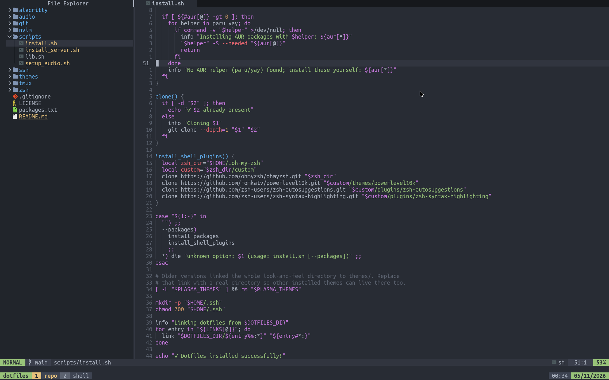

# dotfiles

Configs for zsh (Oh My Zsh + Powerlevel10k), Neovim, tmux, Alacritty, git, ssh
and KDE Plasma themes. Everything is symlinked from this repo, so edits here
take effect right away.

## Desktop (Arch Linux)



Clone anywhere, then run the installer:

```sh
git clone git@github.com:dnslv-pmtkv/dotfiles.git ~/Projects/dotfiles
~/Projects/dotfiles/scripts/install.sh --packages   # first time
~/Projects/dotfiles/scripts/install.sh              # later: links only
```

- `--packages` installs [`packages.txt`](packages.txt) with pacman (lines
  marked `aur:` go through `paru` or `yay` if present) and clones Oh My Zsh,
  Powerlevel10k, zsh-autosuggestions and zsh-syntax-highlighting if missing.
- Existing files are moved to `~/.dotfiles_backup/<name>.<timestamp>.bak`
  before being replaced. Re-running is safe.
- To add a config, add a `"path/in/repo:destination"` line to `LINKS` in
  [`scripts/install.sh`](scripts/install.sh).

After the first install:

```sh
chsh -s /usr/bin/zsh
systemctl --user enable --now ssh-agent.socket   # used by .zshrc and ssh/config
fnm install --lts
```

### Per-machine settings (not tracked)

| File                  | For                                     |
| --------------------- | --------------------------------------- |
| `~/.gitconfig.local`  | git overrides, e.g. a work `user.email` |
| `~/.ssh/config.local` | ssh hosts                               |

### Audio (optional)

`scripts/setup_audio.sh` adds PipeWire virtual sinks (game / discord / music)
looped into the main output. The output device in
`audio/90-mix-to-main.conf` is specific to one machine; change `target.object`
to yours (`pactl list short sinks`) first.

## Server

Installs only git + openssh, links `.gitconfig`, generates an SSH key for
GitHub auth and commit signing, and sets up `allowed_signers`:

```sh
curl -fsSL https://raw.githubusercontent.com/dnslv-pmtkv/dotfiles/main/scripts/install_server.sh | bash
```

Then add the printed public key on GitHub as both an Authentication and a
Signing key. Safe to re-run.
